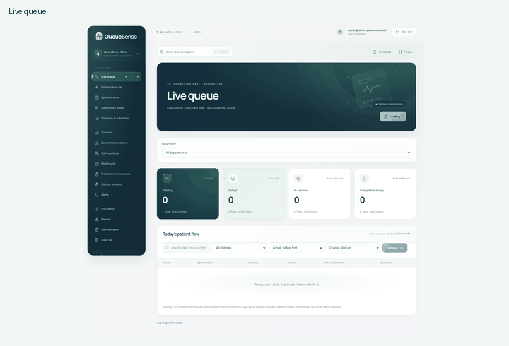
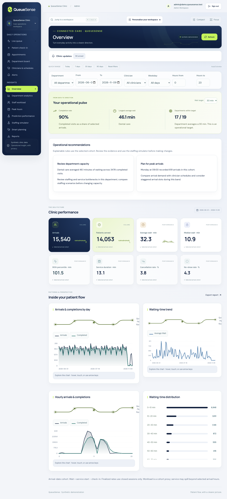
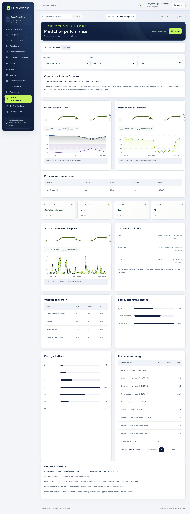
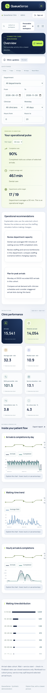

# QueueSense

A full-stack patient-flow and waiting-time analytics application built with Next.js, TypeScript, FastAPI, PostgreSQL and scikit-learn. It connects synthetic check-in/service events to queue visibility, filtered operational analytics and evaluated waiting-time estimates. It is not a clinical decision system.

## Open the application

**Local app:** http://127.0.0.1:3001 · **API docs:** http://127.0.0.1:8001/docs

Choose **Admin → Explore the demo → Enter admin demo** for all features. Reception and Doctor focus on queue operations; Manager has analytics and planning access. All clinic data is synthetic.

The full workspace includes live queue, patient check-in/status, department queue board, clinician availability/schedules, manager analytics, department/workload/peak-hour analysis, model performance, staffing simulation, alerts, CSV import, CSV/PDF reports, user/department administration and audit history. See the [delivery matrix and review guide](docs/DELIVERY.md).

Portfolio review materials: [walkthrough and screenshots](docs/PORTFOLIO.md), [architecture](docs/architecture/system.md), [security review](docs/SECURITY_REVIEW.md), [backup/restore runbook](docs/BACKUP_RESTORE.md), and [staff/student usability review plan](docs/USABILITY_REVIEW.md). Real participant feedback is pending; the usability review document includes a session guide and findings log.

## Product tour



| Live queue | Analytics | Model performance | Mobile |
| --- | --- | --- | --- |
|  |  |  |  |

## Premium interface

The shared visual system now uses an ink-and-teal navigation shell, layered hero artwork, locally hosted DM Sans/Manrope typography, clearer metrics, responsive forms and tables, and consistent appointment, QR and patient screens. Chart legends let you show or hide a series while preserving at least one visible series. Charts also support arrow-key exploration.

Pointer lighting, floating line art, chart-bar entrances, dialog transitions, scroll progress and a keyboard-friendly back-to-top control provide subtle interaction feedback. Reduced-motion preferences disable decorative animation and pointer effects. Local font files and their OFL licenses live under `frontend/public/fonts`, eliminating runtime Google Fonts requests.

Run `node frontend/tests/premium-ui.cjs` with the local app running to verify chart controls, keyboard focus, motion preferences, mobile navigation and all 16 workspace views at 375, 768 and 1440 pixels.

## Workspace enhancements

Use **⌘/Ctrl K** to search the pages available to your role. **Compact** saves a denser layout in this browser; **Focus** hides navigation while retaining workspace search. Live queue and department board support status filtering, token search and sorting by arrival, token or estimated wait.

Analytics includes quick date ranges and an operational pulse showing completion rate, the department with the longest average wait, and departments within a selectable average-wait target. These indicators use the selected cohort; the target is a local planning control. Updated styling includes responsive toolbars, keyboard focus states and reduced-motion support.

Run `node frontend/tests/workspace-tools.cjs` with the local app running to check the new interactions and responsive layouts.

## Appointments, QR arrivals and live updates

Admin and Reception can open **Appointments**, publish half-hour arrival slots (1–20 places, up to 90 days ahead), book a place, cancel a booking and share its private QR link. Check-in opens 30 minutes before the slot and closes 30 minutes after it starts. Arrival slots reserve check-in capacity, not clinician time; checked-in appointments join the ordinary FIFO queue.

In **Patient check-in → Generate today’s QR**, select a department to create a walk-in poster link. It expires at midnight in Asia/Colombo and can be revoked immediately. Patients scan, confirm arrival and open their private token page. Repeating an appointment check-in retrieves the same token; walk-in retry protection uses a browser-stored request ID and an atomic database record. The same browser reuses its token for that department QR; reception can issue an additional legitimate visit. Walk-in QR submissions are limited to 20 new arrivals per minute per code.

Live queue, department board, clinician availability and patient status now receive server-sent events (SSE) after committed database changes. A reconnect refresh reconciles missed changes; a 15-second polling fallback runs while the stream is unavailable. Streams reconnect periodically to revalidate staff sessions. Event payloads contain no patient details or token links. The Next.js proxy forwards streams without buffering.

**Local QR limitation:** `127.0.0.1` links work on this computer. Phone scanning requires a reachable deployed clinic URL configured in `FRONTEND_ORIGINS`; QR generation accepts only configured origins.

After updating an existing installation, run `.venv/bin/python -m backend.bootstrap_product`, rebuild the frontend and restart the local API/frontend. Migration `006_arrivals_realtime.sql` adds booking/check-in tables and PostgreSQL notification triggers; no extra package is required.

Validation: `.venv/bin/python -m backend.verify_local` and, with the app running, `node frontend/tests/arrivals.cjs`. The latter checks booking capacity, QR rendering, anonymous arrivals, retry protection, queue/patient pushes between independent browser sessions, revocation and mobile layouts.

## Start the existing local installation

```sh
.venv/bin/python scripts/start_local.py
```

The native PostgreSQL cluster runs privately on port 55432 with random credentials stored only under ignored `.local/`. The API runs on 8001 and frontend on 3001. Restart API/frontend after code or model changes.

## Fresh local setup

```sh
python3.12 -m venv .venv
.venv/bin/pip install -r backend/requirements.lock
npm ci --prefix frontend
python3 data/generator/generate.py
.venv/bin/python ml/src/train.py
# Install PostgreSQL 17; set POSTGRES_BIN if it is outside the default Homebrew path.
.venv/bin/python -m backend.local_setup
.venv/bin/python -m backend.bootstrap_product
npm run build --prefix frontend
.venv/bin/python scripts/start_local.py
```

On Apple Silicon this workspace uses portable native PostgreSQL binaries installed with `npm install --prefix .local/pg-runtime @embedded-postgres/darwin-arm64@17.10.0-beta.17`; the setup helper detects them automatically. The failed Homebrew download is not needed to run the application.

See [backend configuration](backend/README.md) and [database setup](database/README.md). No production secrets or personal patient records are committed.

## Data, models and verification

The reproducible seed contains 15,265 fictional visits across 90 calendar days, three departments and nine clinicians. Current demo visits add to this baseline. Data dictionary: [data/data_dictionary.md](data/data_dictionary.md).

The selected Random Forest achieves **7.10-minute MAE** on unseen chronological synthetic test data versus **9.62 minutes** for the queue-rate baseline. [Model methodology and limitations](ml/README.md), [evaluation results](ml/evaluation/results.json).

```sh
python3 -m unittest discover -s data/generator -p 'test_*.py' -v
.venv/bin/python -m backend.verify_local
npm run build --prefix frontend
# With the local app running; install Chromium once with npx playwright install chromium.
npm run test:e2e --prefix frontend
```

Verification includes native PostgreSQL migrations/seed/integrity, concurrent token numbering, staff occupancy, role/session controls, lifecycle-to-analytics, import dry-run/errors/duplicates, PDF/CSV output, simulator edges and feature-leakage checks. Chromium checks cover all 15 workspace views, check-in through completion, patient status, forms and responsive layouts. Screenshots: [docs/screenshots](docs/screenshots).

## Architecture and deployment

[System architecture](docs/architecture/system.md) · [ER diagram](docs/architecture/database.md) · [Portfolio wording](docs/PORTFOLIO.md) · [Deployment guide](docs/DEPLOYMENT.md).

Dockerfiles, Compose services and a GitHub Actions workflow are supplied. Docker/CI are not executed here. **The running link is local, not a public deployment.** Cloud hosting, public DNS/HTTPS and a production database must be configured externally before a public release. Optional notifications, real hospital integrations, probabilistic intervals and automatic retraining remain future enhancements.

## Demo recording

[Two-minute synthetic-data walkthrough](docs/demo/queuesense-walkthrough.webm).

## Patient feedback, privacy, PWA and service health

After a completed visit, the private patient-token page offers an optional 1–5 rating and a comment of up to 1,000 characters. Each visit accepts one response, enforced atomically in PostgreSQL. Patients are prompted to avoid identifying or medical information. Admin and Manager can open **Patient feedback**, filter by visit date and department, and review average ratings, waiting-time bands, wait/rating correlation and the latest 100 comments. Undefined correlation appears as an em dash. Voluntary feedback is observational and may be biased; correlation does not establish causation.

Staff access uses Argon2 passwords, hashed rotating sessions, HttpOnly cookies, production Secure cookies, expiry, account deactivation, server-side role checks, origin validation and sign-in throttling. New responses remain behind manager/admin authorization; public patient links expose only submission status. API launchers disable access logging of private token URLs; configure any reverse proxy to redact these paths too. Referrer suppression protects private links, frame protection prevents embedding, and patient/arrival pages are excluded from indexing. Production requires HTTPS origins and disabled demo access. Restrict database access, use encrypted transport/storage and backups in your deployment, and define patient-feedback retention and deletion rules before collecting real patient comments.

The responsive app includes a web manifest, PNG installation icons and a service worker. Browsers supporting installation can install QueueSense over HTTPS (or localhost). Offline navigation displays a generic reconnect page. Patient pages, staff screens, API responses and feedback submissions are never cached or queued by the service worker; current queue operations require connectivity.

Admin and Manager can open **System health** for bounded database, model-inference and PostgreSQL LISTEN/NOTIFY probes. Results refresh every 30 seconds while the page is visible and can be refreshed manually. Machine learning runs inside the API process; absent models report degraded baseline operation. Notification health covers the existing live-update transport; external email/SMS is not configured. `/health` remains the minimal database-backed readiness endpoint, while `/health/services` requires staff authorization. A database outage also prevents staff session validation and is shown as service unavailability by the dashboard.

Existing installations: run `.venv/bin/python -m backend.bootstrap_product`, rebuild the frontend and restart API/frontend. Migration `007_patient_feedback.sql` and the runtime grant add the feedback store without changing existing visits. Verification: `.venv/bin/python -m backend.verify_local`, `npm run build --prefix frontend`, and `node frontend/tests/experience.cjs` with the local app running.

## Roles, patient tracking, operational insights and reporting

Reception coordinates arrivals, appointments and queue operations; doctors control only their assigned clinician; Manager has analytics, simulations, reports, feedback and model monitoring; Admin also manages users, departments and audit history. Every protected API checks the persisted staff session and permissions. Patients use a separate **Track your patient token** entry at `/patient` and their clinic-issued private token link. This capability grants access only to that visit's status and feedback, without granting a staff account or revealing other patients.

Patient tracking explicitly shows people ahead, including called/in-service visits, queue position and a live AI estimate for standard queues, with a compatible-capacity fallback for priority or restricted visits. SSE updates and polling fallback keep status current while patients are away from the waiting area. Patients must remain reachable and follow clinic instructions when called. Estimates are approximate; no available clinician means no reliable estimate.

**Overview → Operational recommendations** adds evidence-backed suggestions for long department waits, peak arrival bands, heavy scheduled workload and rising waiting times. Recommendations use explainable thresholds and the selected date/department/doctor/hour cohort. Sparse data shows a monitoring suggestion. These recommendations are operational rules; waiting-time predictions use the trained machine-learning model. Both operate on synthetic data and require review before clinic changes.

**Reports** now offers complete operational, daily, monthly, doctor, department, waiting-time distribution, peak-hour and detailed-visit reports. Both PDF and CSV use the same selected filters. PDFs paginate with repeating table headers and page numbers. Monthly mean waits are aggregated from measured visits, rather than averaging daily averages. CSV text cells are protected against spreadsheet formula interpretation. Detailed visits are capped at 50,000 for CSV and 5,000 for PDF; aggregate reports are appropriate for broad date ranges. Exports exclude private token links and patient identifiers.

**Prediction performance** includes observed MAE, RMSE, signed bias, daily error trends, comparisons of observed/predicted waits and metrics by model version. Filter by arrival date and department. Monitoring uses one latest prediction recorded no later than service start per served visit; predictions after service begins are excluded. Positive bias indicates underestimation, negative bias indicates overestimation. Empty selections show unavailable metrics. Historical synthetic test evaluation remains separate from operational monitoring.

Patient-facing predictions include local **TreeSHAP** explanations. The private token page shows the model baseline and the strongest input contributions, with positive values increasing and negative values decreasing the model output. Active-service capacity floors are called out separately. Rule-based capacity fallbacks are identified as such and do not receive SHAP claims. Explanations describe model behavior on synthetic data; they do not establish causation or guarantee a wait.

**Audit log** records staff sign-in/sign-out, administrative actions, queue transitions, anonymous patient arrivals, feedback submission and exports. Transition details contain before/after status and clinician ID; exports record report type and filters. Patient comments, passwords and private links are excluded. Admin can filter by date, action/email/entity and exact entity ID, and page through 200 records at a time. The runtime database role can read/append audit records and cannot update/delete them. Queue events and audit records commit together.

Existing installations must run `.venv/bin/python -m backend.bootstrap_product` to apply `008_audit_context.sql`, then rebuild and restart API/frontend. Browser verification: `BASE_URL=http://127.0.0.1:3002 node frontend/tests/operational.cjs` when using the review instance on port 3002.

## Smart planning and capacity scenarios

Open **Smart planning** in a staff workspace. Reception and Doctor can review doctor matching and workload suggestions; Manager and Admin also have forecasts and staffing comparisons. Admin can configure doctor service profiles. Profiles contain clinic-confirmed supported services (general consultation, follow-up, document review, accessible consultation) and languages (English, Tamil, Sinhala). Existing doctors default to general consultation; language support starts unconfigured, so language-required visits match only explicitly configured profiles.

**Patient check-in** can record a required service, language, preferred doctor and required continuity. Doctor recommendations match those requirements within the selected department, exclude offline/break clinicians and estimate service availability from current workload and historical service duration. Busy doctors show estimated remaining service; earlier compatible waiting visits are allocated in FIFO order for the estimate. Required continuity restricts matching to the preferred doctor. The API validates manual calls and **Call next** against the persisted requirements; incompatible assignments are rejected. Patients can see suitable options on their private status page and discuss changes with reception. Matching is an operational service filter and does not infer clinical suitability from symptoms or diagnoses.

**Intelligent load balancing** detects queues exceeding their department threshold and suggests the earliest eligible standard visit for an idle compatible doctor. It excludes required continuity, non-standard priority and already assigned visits, and preserves order among eligible patients. Suggestions stay within the same department's shared queue; there are no automatic transfers. Staff review patient consent/eligibility and use normal queue controls to call patients. Executed calls retain the existing audit trail.

**Peak-hour forecasts** use the weekday/hour mean and 80th-percentile planning demand from closed operating sessions in a configurable 4–26-week window ending at the last historical closed session. Known zero-arrival hours are included in the denominator. At least three comparable operating days are required; otherwise the screen reports insufficient history instead of inventing demand. Forecasts cover today through the next 30 days, show sample counts/date ranges and flag history ending more than 28 days before the forecast.

**Staffing recommendations** combine planning demand, bounded historical average service time, a selectable utilization buffer and current-hour queue backlog spread over the chosen clearance period. They provide hourly capacity counts. Current available/busy doctors are a live snapshot, not future roster coverage. Clinic minimum staffing and the required service/language skill mix must be reviewed separately.

**What-if staffing comparison**, also available in **Staffing simulator**, compares baseline and proposed doctor counts, including adding/removing one doctor and zero staffing. Outputs include initial wait, capacity, expected completions, remaining queue, clearance and stability over a selectable 15–480-minute period. Peak-period cards can fill the simulator with forecast inputs. The deterministic model assumes interchangeable eligible clinicians, constant arrivals and service time, and no breaks or variability. It does not modify live queues or schedules.

Run `.venv/bin/python -m backend.bootstrap_product` to apply `009_operational_planning.sql`, then rebuild/restart the services. API routes: `/planning/doctors`, `/planning/balance`, `/planning/forecast`, `/planning/simulate`, `/admin/staff/{id}/profile`, and private `/patient/{key}/doctors`. Browser verification: `BASE_URL=http://127.0.0.1:3002 node frontend/tests/planning.cjs`.

## Early warnings, appointment risk and automated updates

**Alerts → Congestion outlook** projects queue size and approximate waiting time 15, 30 and 60 minutes ahead. It combines current waiting visits, available/busy clinicians, estimated remaining service, recent walk-in flow and upcoming booked arrivals. Walk-ins exclude already checked-in appointments to avoid double counting. All bookings count toward demand; no-show risk never reduces reserved capacity. Departments with patients lacking a compatible clinician are flagged for review. These are explainable capacity projections, not trained congestion-model probabilities or guarantees.

**Appointments** now shows attendance confirmation, booking-risk level and its reasons. The baseline score uses missing confirmation, an imminent/overdue arrival and booking lead time of at least seven days. Patients confirm attendance from their private appointment page. This is a rule-based risk indicator, not a calibrated patient probability; the app does not collect identifiable patient-history features. Staff retain cancellation decisions. When no linked check-in is recorded by the end of the existing 30-minute grace period, automation records a missed-arrival outcome and an audit entry; it does not cancel or overbook the appointment. Arrivals issued separately at reception cannot establish attendance for an unlinked booking.

**Clinic updates** is a collapsible inbox near the top of every staff workspace. Private appointment and token pages have their own inboxes. Booking/cancellation and queue status notifications commit with the underlying change; queue calls do not wait for the background cycle. The API worker runs at startup and every 30 seconds to send reminders within 24 hours, one hour and the arrival window, recalculate waiting estimates and warn staff about congestion or high booking risk. It sends the most relevant reminder after downtime, rather than replaying older reminder stages. Waiting estimates use the same calculation as the live patient page; updates are grouped into five-minute bands to limit noise, and coverage/delay changes also trigger updates.

Notifications persist in PostgreSQL with unique event keys and a transaction advisory lock to prevent duplicates across API workers. Staff read receipts belong to each user; private-link reads are restricted to that booking/token. Inboxes refresh every 15 seconds. Browser alerts are explicitly enabled by the user, display generic text to protect privacy and work only while the page is open. This implements in-app delivery; external SMS/email and closed-browser push require separately configured delivery infrastructure.

**System health** includes the automation worker's last successful cycle (healthy within two minutes). Set `ENABLE_AUTOMATION=false` to disable scheduled cycles for maintenance; status alerts created by queue transactions still persist. Apply `010_smart_automation.sql` and runtime grants with `.venv/bin/python -m backend.bootstrap_product`, rebuild and restart API/frontend. API routes include `/planning/congestion`, `/appointments/risks`, `/notifications`, private `/patient/{key}/notifications`, `/self-checkin/{key}/notifications`, `/self-checkin/{key}/confirm`, and scoped notification read endpoints. Browser verification: `BASE_URL=http://127.0.0.1:3002 node frontend/tests/automation.cjs`.


## Smart check-in and live waiting-time prediction

**Patient check-in** automatically issues a unique department/day token and private tracking link, with a scannable tracking QR and copy-link action on the receipt. Reception/Admin can choose standard or expedited priority. Expedited priority requires a clinic policy or staff authorization reference (no medical details); it is recorded in the audit trail. Anonymous QR arrivals always enter standard priority and cannot supply priority fields. **Call next** chooses the first compatible expedited visit, then standard visits, with arrival order preserved within each priority. Staff can still explicitly call a token using existing audited controls.

The live queue and private patient pages share priority-aware position calculations and live waiting estimates. Standard, unrestricted queues use batch inference from the existing trained Random Forest with current demand, time, clinician availability and historical service duration. Busy clinicians' remaining service prevents estimates promising immediate service before a clinician is free. Priority, service/language restrictions and continuity requirements use an explainable compatible-doctor workload calculation because those policies are outside the model's training features. Missing, failed or non-finite model outputs fall back to capacity estimates; no compatible clinician yields no estimate. Only today's active waiting visits affect order, and rank calculations use the full queue even when the staff list displays its 500-row limit.

The initial check-in prediction, version and timestamp are retained separately from changing live estimates. When service begins, staff and patients can see the actual wait, initial prediction and signed error. **Prediction performance** refreshes on queue events and compares the latest recorded pre-service prediction (or the retained check-in snapshot, including operational fallbacks) against actual waiting time. Existing MAE/RMSE/bias trends and model-version comparisons remain available. The model is trained/evaluated on synthetic data; live estimates and synthetic evaluation scores do not establish real-clinic accuracy. Automatic notifications now use the same live prediction calculation as the patient page.

## CI and load testing

GitHub Actions runs generator tests, PostgreSQL-backed backend tests, frontend TypeScript checks and a production build on every push and pull request. See [`.github/workflows/ci.yml`](.github/workflows/ci.yml).

An optional Locust scenario exercises the API health and private patient-status endpoints with 100 virtual users. Each user waits 12–18 seconds between requests, approximating periodic status refresh and staying within the API's process-wide 600 token reads/minute guardrail. The local run sent 1,203 requests with zero failures; setup and limits are in the [load-test report](docs/LOAD_TEST.md). Against the local synthetic database, run:

```sh
.venv/bin/python scripts/run_local_loadtest.py
```

Load-test outcomes depend on the host, database, fixture and request mix; a local run does not prove production capacity. Never run load tests against a clinic or other production service without authorization.

Apply `011_checkin_predictions.sql` with `.venv/bin/python -m backend.bootstrap_product`, then rebuild/restart. Browser verification: `BASE_URL=http://127.0.0.1:3002 node frontend/tests/core-queue.cjs`. Private tracking QR endpoint: `/patient/{key}/qr?origin=<configured-clinic-origin>`; QR responses are not cached.
