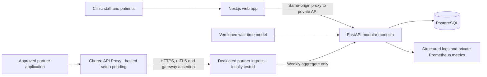
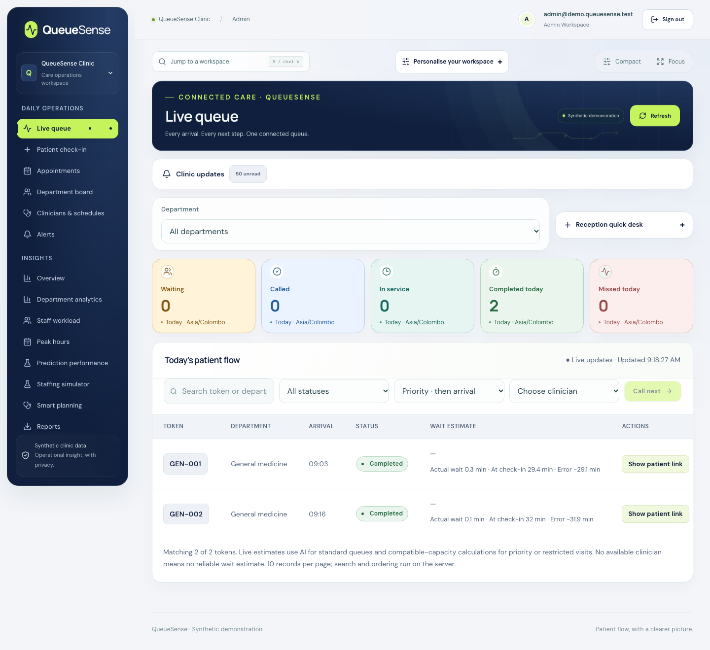
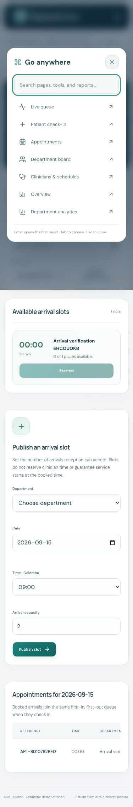

# QueueSense Enterprise

**A patient-flow and waiting-time analytics application with a Choreo API Management integration prepared for staging.**

QueueSense connects reception check-in, clinician queue updates, and private patient tracking. It gives a clinic one place to review why waits grow, compare staffing scenarios, and prepare a narrowly scoped weekly wait report for approved integrations.

[Watch the recorded product walkthrough · 2:07](docs/demo/queuesense-walkthrough.webm) · [Run the synthetic demo](docs/DEPLOYMENT_GUIDE.md#run-the-full-synthetic-demo) · [Read the Choreo contribution report](docs/CHOREO_INTERNSHIP_CONTRIBUTION_REPORT.md)

**Verification status:** The clinic app, Docker stack and local HTTPS partner ingress passed synthetic staging checks. Hosted Choreo deployment, API publication and subscriptions remain pending organization access. The recording shows the local product. [Verification evidence](docs/TESTING_REPORT.md)

## Problem and objectives

Patients often lack a reliable view of their place in line. Receptionists and clinicians need a shared queue, and managers need enough history to distinguish a short spike from persistent understaffing. QueueSense aims to keep queue changes consistent when staff act concurrently, show each patient only their linked visit, and turn recorded waits into operational reports.

## What you can demo

| Role | Workflow |
| --- | --- |
| Patient | Confirm an arrival with a private link or QR code, follow queue progress, and leave eligible visit feedback. |
| Receptionist | Register a patient, issue or reprint a private token, book appointments, and manage arrivals. |
| Doctor | Work from the assigned clinician station, update availability, and start or complete service. |
| Manager | Compare department waits and peak hours, simulate staffing, and export aggregate CSV/PDF reports. |
| Administrator | Manage staff, clinicians and departments, review audits, and validate historical CSV imports. |

Live queue updates use PostgreSQL notifications and server-sent events, with a polling fallback. A Random Forest estimates waits for standard visits. Capacity-based estimates handle constrained visits or unavailable model output. [Product guide](docs/PRODUCT_GUIDE.md) · [Permissions](docs/ROLE_PERMISSION_MATRIX.md)

## System architecture



Next.js and FastAPI run as separate processes. FastAPI keeps identity, queues, arrivals, analytics and predictions within one application so related queue writes can share a PostgreSQL transaction. The schema enforces per-session token uniqueness, one active visit per identified patient per session, and one active service per clinician. [System architecture](docs/SYSTEM_ARCHITECTURE.md) · [Database ER diagram and migrations](docs/DATABASE_DESIGN.md)

| Layer | Stack |
| --- | --- |
| Web | Next.js, React, TypeScript and Playwright |
| API and data | Python, FastAPI, PostgreSQL 17, Psycopg and SQL migrations |
| Analytics | SQL, Pandas, scikit-learn and SHAP |
| Delivery and reliability | Docker Compose, GitHub Actions, Locust and Prometheus |
| Partner integration | OpenAPI 3.0.3, Choreo API Proxy and Developer Portal workflow, dedicated Nginx HTTPS ingress |

## API, authentication and traffic

- **Clinic API.** The browser uses same-origin Next.js routes. Private `/api/v1` resources cover authentication, patients, queues, doctors and analytics. FastAPI validates short-lived staff JWTs and checks the current session, role and resource ownership in PostgreSQL. Refresh credentials rotate server-side. Patients use visit-scoped links. [REST reference](docs/API_REFERENCE.md) · [JWT flow](docs/SECURITY_ARCHITECTURE.md)
- **Partner API.** During rollout, Choreo can be configured to accept an approved application's OAuth token and forward a signed backend assertion over mutual TLS. The implemented origin verifies that assertion and returns one department's weekly wait aggregate. Cohorts with fewer than 10 measured waits are suppressed. [Gateway flow](docs/SYSTEM_ARCHITECTURE.md#partner-gateway-request-flow) · [OpenAPI](api-management/openapi.yaml) · [Postman collection](api-management/queuesense.postman_collection.json) · [Subscription guide](docs/DEVELOPER_PORTAL_GUIDE.md)
- **Rate limits.** PostgreSQL enforces quotas across API workers by staff account, capability or approved partner department. A patient link allows 40 reads/minute, and the partner origin allows 30 reads/minute. FastAPI returns 429 with `Retry-After` when those limits are reached. The live Choreo quota remains pending verification. [Traffic policy](docs/TRAFFIC_MANAGEMENT.md) · [API documentation](docs/API_DOCUMENTATION.md)

## Run or review

For a fresh machine, follow the [deployment guide](docs/DEPLOYMENT_GUIDE.md) to seed the local demo, enable JWT mode, and start Next.js and FastAPI. Open `http://127.0.0.1:3001`, select **Admin → Explore the demo → Enter admin demo**, and issue a token from **Patient check-in**. Open the private tracker in a second tab, then call, start and complete the visit in the staff queue. In development, interactive API documentation is at `http://127.0.0.1:8001/docs`.

To verify the container stack from the application repository root with Docker running:

```sh
python3 scripts/smoke_compose.py --faults
```

The smoke provisions a disposable database, tests token persistence, and exercises controlled PostgreSQL and FastAPI outages. [Docker setup](docs/DOCKER_SETUP.md) · [CI/CD architecture](docs/DEPLOYMENT_GUIDE.md#cicd-architecture) · [Production checklist](docs/DEPLOYMENT_CHECKLIST.md)

## Testing, performance and monitoring

- **Tests.** 150 backend tests and 8 Chromium scenarios passed. Coverage includes concurrent registration and token issuance, role and ownership enforcement, browser check-in through completion, and proxy error handling. Hosted GitHub Actions execution remains pending. [Testing report](docs/TESTING_REPORT.md)
- **Load.** Locust tested 10, 50 and 100 concurrent users against one local worker. At 100 users, p95 went from **60 ms to 44 ms** at about 15 requests/s, with zero errors in both runs. Token issuance p99 increased from 77 ms to 120 ms. [Full benchmark](docs/PERFORMANCE_REPORT.md)
- **Prediction.** Random Forest achieved **7.10 min MAE** versus **9.62 min** for the operational baseline on a chronological synthetic holdout. [Model evaluation](ml/README.md)
- **Monitoring.** JSON logs carry request and trace IDs. Private Prometheus metrics record request rate, 4xx/5xx/429 and latency. Separate liveness and PostgreSQL readiness probes help diagnose outages. Hosted Choreo Insights and alert setup remain pending. [Monitoring guide](docs/MONITORING.md)

## Screenshots and demo

| Live queue | Operational analytics | Mobile workspace |
| --- | --- | --- |
|  |  |  |

[Download the existing WebM walkthrough](docs/demo/queuesense-walkthrough.webm) · [Four-minute narration and recording plan](docs/DEMO_VIDEO_SCRIPT.md) · [Technical interview guide](docs/TECHNICAL_INTERVIEW_GUIDE.md)

## Future improvements

1. Verify a hosted Choreo Development proxy, approved subscription, gateway limits and portal visibility with synthetic traffic.
2. Run sustained staging loads with concurrent SSE users and investigate token issuance tail latency.
3. Add a staging backup/restore rehearsal, alert delivery drill and approved span export.
4. Evaluate predictions and privacy controls with governed data before a clinic pilot.

[Project overview](docs/PROJECT_OVERVIEW.md) · [Technical decisions](docs/TECHNICAL_DECISIONS.md) · [Contribution and evidence](docs/CHOREO_INTERNSHIP_CONTRIBUTION_REPORT.md)
