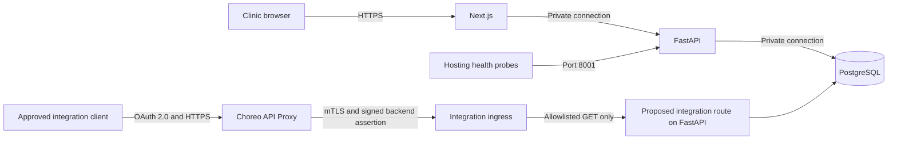

# QueueSense API exposure

Stage 10 preparation record. For the implemented partner origin and current console steps, see the [Stage 11 gateway design](gateway-design.md) and [proxy configuration](proxy-configuration.md).

## Deployment and addresses

| Caller | Base address | Use |
| --- | --- | --- |
| Local workstation | `http://127.0.0.1:8001` with the default native or Compose mapping | Call `GET /health` or test the private FastAPI API directly. A temporary local image can use a different mapped host port. |
| Next.js in Compose | `http://api:8001` | Compose service address used by `AUTH_API_URL`. On a hosted deployment, set `AUTH_API_URL` to the verified private FastAPI address of that environment. |
| Choreo backend Service | Deployment-assigned private address on container port `8001` | Read the endpoint details of the active Development deployment. With project visibility, verify connectivity from a component in that project. |
| Choreo API Proxy target | Approved gateway-reachable HTTPS origin, with the origin base path appended | The preview origin base is `/api/v1/analytics`. The proposed separate partner origin base is `/api/integrations/v1` once implemented. The actual host depends on provisioning and ingress. |
| Partner application | Invocation URL shown for the intended environment and API version | Copy it from the verified deployment or Developer Portal after publication. The gateway adds its own context and version. |

The current contract combines `servers[0].url = /api/v1/analytics` and `GET /waiting-time`, yielding the existing FastAPI operation `GET /api/v1/analytics/waiting-time`. For a private preview import, set Choreo's Target to the verified integration ingress origin plus `/api/v1/analytics`. Keep the imported resource path `/waiting-time`. Check the resulting request at the origin so the prefix is added exactly once. Localhost and Compose DNS belong to their respective local networks. [Official API Proxy target and resources workflow](https://wso2.com/engineering-platform/developer-platform/docs/develop-components/develop-proxy/develop-an-api-proxy-from-an-open-api-specification/)

## Exposure decision

Deploy FastAPI as a **Service** when running its image on Choreo. Keep its service endpoint at **Project** visibility for the initial hosted check. A Service REST endpoint at **Organization** or **Public** visibility can itself be a managed API when its whole exposed surface is an appropriate contract. QueueSense currently serves staff, patient, kiosk and administration routes on one port, so use private connectivity for the Service and a separate API Proxy for the eventual partner contract. If QueueSense is hosted elsewhere, deploy only the API Proxy in Choreo and use a verified HTTPS integration ingress at the existing host. [Official Service endpoint and visibility options](https://com-migration.wso2.com/choreo/docs/develop-components/configure-endpoints/)

| Surface | Exposure |
| --- | --- |
| `GET /health` | Private HTTP readiness probe on port 8001. Use a TCP probe on port 8001 for process liveness so a database outage does not restart the API. |
| `GET /api/v1/analytics/waiting-time` | Owner-operated synthetic origin preview. The exported contract documents the current staff bearer requirement and includes the real filters. |
| `GET /api/integrations/v1/wait-time-summary` | Planned first partner operation from the existing Stage 02 design. Implement caller scope and department grants, cap the date range, suppress undersized cohorts, and omit the staff filter before publication. |
| Staff authentication, admin, patient and kiosk links, queue mutation, imports, visit reports, streams and full OpenAPI | Keep on the existing private or browser paths. Exclude these resources at the integration ingress and gateway. |

An OpenAPI allowlist describes intended operations. Also enforce the HTTP method and path at the origin ingress, then verify both direct-origin rejection and gateway rejection for excluded paths. Prefer private gateway reachability where the data plane can route to that ingress. If a publicly routable origin address is required, enforce gateway client certificate validation and an explicit path allowlist there. [Deployment architecture](../docs/DEPLOYMENT_ARCHITECTURE.md) · [Official gateway-to-origin mTLS](https://wso2.com/engineering-platform/developer-platform/docs/authentication-and-authorization/secure-communication-between-the-choreo-gateway-and-your-backend-with-mutual-tls/)
