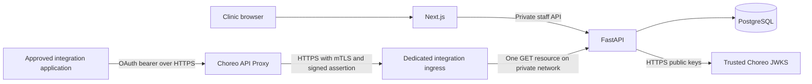

# QueueSense Gateway design

## Decision

Use a separate Choreo **API Proxy** for the single partner-facing report. A Choreo **Service** is the right component for running FastAPI, with the origin kept private. Publishing the existing Service as its own managed API would couple the partner release to the FastAPI application that also serves clinic authentication, patient workflows, and administration. A separate proxy gives the partner API its own resource allowlist, credentials, and rollout. The trade-off is one more hop and a separate proxy configuration to test during releases. [Official endpoint visibility](https://com-migration.wso2.com/choreo/docs/develop-components/configure-endpoints/) · [Official REST API Proxy workflow](https://wso2.com/engineering-platform/developer-platform/docs/develop-components/develop-proxy/develop-an-api-proxy-from-an-open-api-specification/)

## Route and trust model

The partner resource is `GET /wait-time-summary`. The proxy Target ends in `/api/integrations/v1`, so FastAPI receives `GET /api/integrations/v1/wait-time-summary`. The gateway contract is [openapi.yaml](openapi.yaml). The Stage 10 [staff preview](staff-preview.openapi.yaml) describes a separate existing staff endpoint.

- Choreo verifies the consumer OAuth token and applies subscription and gateway policies. The HTTPS ingress requires Choreo's client certificate. It forwards just the integration operation and discards the consumer `Authorization` and cookies.
- FastAPI verifies a single `X-JWT-Assertion` with RS256 through the configured Choreo JWKS, requires issuer, audience, issuance, expiry and token ID, and checks the exact signed `http://wso2.org/claims/apicontext`. The origin grants that context access to one department. The official client-credentials example omits an application identifier, so the integration uses the signed proxy context as its origin authorization boundary. The pilot supports one proxy context and one department per configured FastAPI deployment. Confirm subscriptions are restricted to the approved application set. Support for distinct grants within one proxy would require an independently verified application claim or another trusted client identity mechanism. [Official backend assertion claims and JWKS](https://wso2.com/engineering-platform/developer-platform/docs/developer/authentication-and-authorization/pass-end-user-attributes-to-upstream-services/)
- Calls specify the authorized department UUID and the Monday of a completed clinic week in Asia/Colombo. The service returns count and wait statistics in minutes, or `suppressed: true` and `metrics: null` when fewer than ten waits were measured. Fixed non-overlapping weeks prevent callers from varying date windows around a single visit. The suppression threshold is a pilot safeguard and still needs a privacy review before using real patient data. Repeated calls can reflect late corrections.
- The API route is absent when the integration configuration is empty. Keep port 8001 off the public network. The installed ingress config allows one path and HTTP method. Clinic login, patient links, reports, streams, health and the live API schema stay outside the gateway contract.
