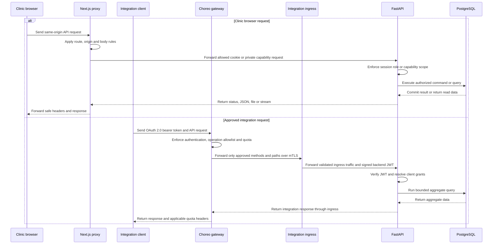

# QueueSense Enterprise API architecture

**Target design · Stage 2 · 25 November 2026**

QueueSense has two HTTP surfaces. Existing browser calls continue through the same-origin Next.js proxy, including cookie-backed staff routes and private capability routes. Approved applications use an OAuth 2.0 API managed by Choreo. Its gateway calls a separately allowlisted integration ingress on the same FastAPI deployment. Both surfaces reuse the application use cases. [Existing routes](EXISTING_ARCHITECTURE.md#fastapi-operation-inventory) · [System architecture](SYSTEM_ARCHITECTURE.md)

## API request flow

## Proposed pilot contract

| Base or route | Contract |
| --- | --- |
| Internal browser surface | Preserve existing URLs, status codes, cookies, SSE behavior, and file responses. Keep the Next.js proxy allowlists in sync with the browser-facing API. |
| Managed integration API | Expose one approved read-only route first, with a separately versioned contract. The candidate FastAPI origin path is `GET /api/integrations/v1/wait-time-summary`. Confirm the gateway URL and route mapping during the staging import. |
| Wait-time summary | Accept a date range and authorized department identifier. Return a bounded summary such as cohort date range, eligible visit count and measured wait statistics. Return a documented unavailable result for insufficient sample sizes. Omit visit-level data, contact data, identifiers for individual visits and free text. Confirm suppression rules, permitted filters and cohort visibility before publishing. |
| Access | Map the verified integration identity to a local client grant such as `analytics:read` with an approved department set. Unknown and over-scoped consumers fail closed. |
| Initially excluded from Choreo | Staff login, recovery and administration, patient and kiosk links, queue mutations, private SSE, reports/downloads, import, internal health and the full FastAPI schema. |

Use typed response models, stable operation identifiers, bounded query ranges, and UTC timestamps where timestamps are needed. Document the clinic timezone for cohort dates and minutes as the wait unit. Keep additive changes compatible within a major API version. Require a new major version and a deprecation plan for breaking changes. If list endpoints are added later, define bounded pagination and stable ordering before release.

FastAPI should emit a stable error body for errors generated by QueueSense, including a safe machine code and correlation ID. Use 401 for invalid credentials, 403 for denied permissions, 422 for validation, 429 for an application quota breach, and 503 for temporary unavailability. Choreo can reject requests before FastAPI, so the contract should describe gateway responses as a separate source and test their observed status, headers and body. Use `Retry-After` where QueueSense can supply it reliably and document the gateway headers observed in staging.

## Traffic policies

| Enforcement point | Responsibilities |
| --- | --- |
| Choreo gateway | Apply API-level or operation-level limits per environment and use subscription plans when required for consumer quotas. Choose pilot limits from the query cost, load-test results and agreed partner usage. [Official API rate limiting](https://wso2.com/engineering-platform/developer-platform/docs/api-management/api-rate-limiting/) · [Subscription plans](https://wso2.com/engineering-platform/developer-platform/docs/administer/create-api-subscription-plans/) |
| Integration ingress and FastAPI | Enforce a strict method/path allowlist at ingress. Apply origin-side timeout, body size, query budgets, bounded DB concurrency and local client grants. This protects the origin when request cost varies at a fixed gateway request rate. |
| Clinic web edge and FastAPI | Keep browser login and kiosk protections. Add distributed per-route limits for costly patient reads and concurrent streams where measured demand justifies them. Accept forwarding data only from trusted ingress. Preserve SSE heartbeat, reconnect and authorized snapshot refresh. |

## OpenAPI, Developer Portal and compatibility

1. Generate a curated OpenAPI document from the integration router or compare a versioned specification with that router in CI. Describe the consumed OAuth 2.0 flow, examples using synthetic data, validation and failure responses, quotas and deprecation policy.
2. Import the approved contract into a Choreo API Proxy. Verify method/path mapping, security, certificate trust, errors and rate limits in staging. Keep internal API docs restricted to maintainers. [Official OpenAPI proxy workflow](https://wso2.com/engineering-platform/developer-platform/docs/develop-components/develop-proxy/develop-an-api-proxy-from-an-open-api-specification/)
3. Publish to the intended Developer Portal audience only after consumer and data approval. Create a test application, subscribe and verify a real authenticated request through the gateway in that environment. [Official subscription workflow](https://wso2.com/engineering-platform/developer-platform/docs/developer/consuming-services/manage-subscription/)

The design adds an independent external contract and makes consumers easier to onboard. It also adds one proxy hop, a second authorization surface, and drift risk between runtime routes, published OpenAPI and proxy policies. Route parity, negative exposure tests and subscribed smoke tests are required evidence before release.
