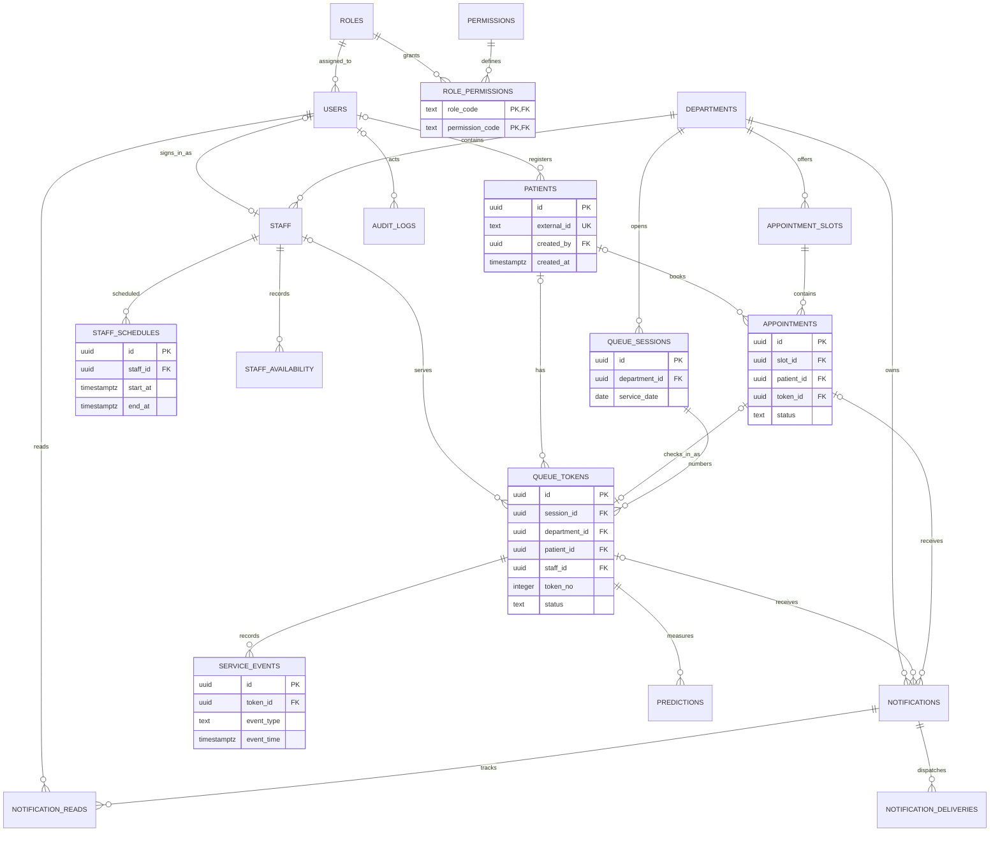

# QueueSense database design

QueueSense uses PostgreSQL 17 and one database per clinic installation. Department, clinician, booking, queue and patient references are UUIDs. Roles and permissions use stable text codes. Times are stored as `timestamptz`, while a queue session's service date follows its department timezone. Migrations 013 and 014 extend the existing schema in place.

## Entity relationships



## Ownership, constraints and indexes

| Area | Database rules |
| --- | --- |
| Users, roles and permissions | A unique normalized email identifies a staff account. `users.role` references a seeded role. `role_permissions` has a composite primary key and two foreign keys. The first database-backed grants cover patient registration, staff check-in and arrival-slot booking. They preserve admin/reception access. Migration 015 adds registry reads for admin/reception and clinic identifier correction for administrators. The existing application policy still controls other operations. |
| Patients | Store a UUID, unique canonical clinic identifier, creator and creation time. Identifiers are ASCII, trimmed and case-insensitive through API normalization. Registration returns the registry UUID to authorized staff. The audit stores that UUID as an entity reference. The clinic identifier stays out of audits, public responses, notifications, and analytics payloads. Existing synthetic identifiers continue to identify visits. Legacy tokens and bookings remain unlinked. |
| Clinicians and departments | Doctors are `staff` records with `staff_type='doctor'`. A unique optional user reference links a clinician to their staff account. Composite foreign keys prevent cross-department assignments. |
| Schedules and availability | Positive shift duration and a unique start time already apply. A partial GiST exclusion constraint prevents overlapping scheduled shifts for one clinician, even for direct concurrent writes. It permits adjacent shifts and excludes cancelled shifts. Availability remains append-only through the app and has a latest-per-clinician index. One called or in-service token per clinician is enforced by a partial unique index. |
| Appointments | Slots have an immutable department, a unique start and bounded capacity. The booking transaction locks the slot before checking capacity. A partial unique index permits one non-cancelled booking per identified patient per slot. A booking can attach one token. The trigger requires matching patient and department. |
| Queue | One department session per service date. `(session_id, token_no)` is unique. The active-patient index permits one waiting, called or in-service visit per patient per session. Completed, cancelled and missed visits remain available for history and allow later visits. A separate index supports patient visit history. Legacy anonymous/manual arrivals retain their prior behavior. |
| Queue status history | Queue status and timestamps are validated on the token. `service_events` stores unique event types per visit with matching time and clinician. Transitions append events, availability and audit data within the same transaction. Patient linkage and a called token's clinician are immutable. Historical waits remain derived from `service_start_at - check_in_at`; existing predictions and model versions are preserved. |
| Notifications and audit | Notification rows reference tokens or bookings according to audience. Migration 014 adds same-department enforcement for new token notifications and retains legacy rows pending validation. Read receipts and outbound delivery jobs retain their existing unique keys. Audit rows capture the actor when present and retain the polymorphic entity reference. An actor/time index supports audit review and the runtime has insert/read privileges. |

## Registration and transaction behavior

- Reception and admin can call `POST /patients` through the same-origin `/api/service/patients` proxy. Submit `external_id` from the clinic's record system. PostgreSQL resolves concurrent inserts on the unique identifier. A new registration returns 201 and a repeat returns 200 with the same `id`. Each newly registered patient is audited once.
- Supply an optional `patient_id` on `POST /queue/check-in` or `POST /appointments`. An unknown UUID returns 404 and a duplicate active visit or booking returns 409. If an appointment's QR check-in encounters a prior active token for its patient, it returns 409 and leaves the booking unchanged. Staff can reconcile the visit using the clinic's existing queue workflow.
- Check-in holds the existing transaction-scoped queue advisory lock and locks the department/day session row before allocating the next token number. The unique token number and active-patient indexes enforce correctness at commit. A failed issuance rolls back the token, its events, audit rows, and any booking linkage.
- Booking retries at check-in reuse the attached token. Walk-in kiosks continue to use the existing `(kiosk_id, request_id)` retry key. Anonymous manual check-ins do not have an identity to match. They can represent separate visits.
- The global queue lock intentionally remains for compatibility. Measure lock waits before narrowing it. Availability, shift planning and queue lifecycle remain separate records so current operational status and historical coverage can be reported independently.

## Migration and deployment workflow

The repository already has a forward-only SQL runner with an advisory transaction lock and a checksum ledger. Keep it and append new migration files. Adding an Alembic history here would introduce a second source of truth for the existing SQL and triggers. [Migration runner](../database/scripts/manage.py)

1. Back up the target database and run the upgrade against a copy with production-shaped data. Check for overlapping active shifts and review cross-department historical notifications. PostgreSQL must provide `btree_gist` and the migration identity must be able to use it or have a database administrator provision it. The exclusion index is created inside the migration transaction, which can block schedule writes while it builds.
2. Apply migrations 013 and 014 as the database owner using `.venv/bin/python database/scripts/manage.py migrate` with an owner `DATABASE_URL`. The exclusion constraint requires all existing scheduled shifts to be non-overlapping. On conflict the migration rolls back and leaves their rows intact. Review the conflicting business records before retrying. No migration fabricates identities, drops records, or rewrites historical timestamps.
3. Reapply [runtime grants](../database/sql/product_runtime_grants.sql) before starting the updated API. Keep provisioning and migration credentials out of the application. Migration 015 grants versioned operations registry read and correction permissions. Reapply the auth and product runtime grants for the v1 API. The runtime can update only the clinic identifier column and has no registry delete or role policy write privileges.
4. Re-run the migrator to confirm all checksums match. After checking legacy notifications for mismatched departments, an operator can run `ALTER TABLE notifications VALIDATE CONSTRAINT notifications_token_department_fkey` on a clean dataset. Until then the constraint enforces new or changed token references. Re-run native checks against a test environment. [Database setup](../database/README.md) · [Backup and restore](BACKUP_RESTORE.md)

Examples of read-only preflight checks against the intended schema

```sql
SELECT a.id AS first_shift, b.id AS second_shift
FROM staff_schedules a
JOIN staff_schedules b
  ON a.staff_id = b.staff_id AND a.id < b.id
WHERE a.status = 'scheduled' AND b.status = 'scheduled'
  AND a.start_at < b.end_at AND b.start_at < a.end_at;

SELECT n.id
FROM notifications n
JOIN queue_tokens t ON t.id = n.token_id
WHERE n.department_id <> t.department_id;
```

## Verification

- `npm test --prefix database` seeds the pre-013 schema, verifies existing row snapshots after migration, checks legacy analytics parity, and exercises database constraints in transactions that are rolled back.
- `.venv/bin/python -m backend.verify_local` checks native PostgreSQL migration replay, runtime grants, SQL integrity, and application tests. Native concurrency tests race two staff sessions against the patient registry and the same active visit. Existing tests cover parallel anonymous token numbering, lifecycle, booking capacity, shifts, and reports.
