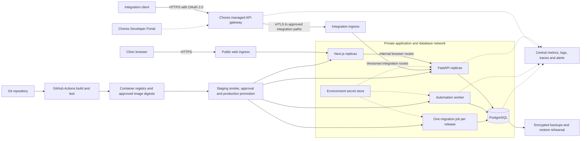

# QueueSense Enterprise deployment architecture

**Target design · Stage 2 · 25 November 2026**

Use the existing Docker build paths and GitHub Actions as a starting point. Deploy independently built Next.js and FastAPI images, a PostgreSQL instance with private connectivity, and one controlled migration job per environment. Run automation and provider delivery from the FastAPI image in a distinct process when decoupling the worker from web replicas. This permits separate scheduling while keeping one backend codebase and database. [Compose baseline](../docker-compose.yml) · [CI baseline](../.github/workflows/ci.yml)

## Deployment topology

### Environment and connectivity

| Environment | Purpose and boundaries |
| --- | --- |
| Local and CI | Start from Compose or the native setup with synthetic fixtures. Run database migrations, browser smoke and contract tests with disposable state. Use local signing fixtures and mocked providers where appropriate. |
| Staging | Deploy production-shaped infrastructure with its own database, secrets, gateway settings, audience and approved test subscription. Measure realistic synthetic traffic and verify mTLS, claims, route mappings, failure responses and rollback. |
| Production | Promote the same tested image digests through approval. Use a separate private database, runtime credentials, authorized consumer subscriptions and separately validated ingress controls. Promote or publish gateway changes only through the confirmed workflow for that organization. |

Keep Next.js public over HTTPS and its FastAPI connection private. Place a dedicated integration ingress before FastAPI so the Choreo gateway reaches only the approved route set. Use verified private connectivity if available. A gateway-reachable HTTPS ingress restricted by mTLS and a path/method allowlist is an alternative when the selected hosting topology cannot route privately. Confirm reachability, TLS certificate rotation and source authentication in staging. PostgreSQL and the FastAPI service itself stay on private networks. [Official gateway-to-origin mTLS guide](https://wso2.com/engineering-platform/developer-platform/docs/authentication-and-authorization/secure-communication-between-the-choreo-gateway-and-your-backend-with-mutual-tls/)

### Automated delivery and recovery

1. On pull requests, run deterministic dependency installs, backend tests against PostgreSQL, browser checks on synthetic fixtures, contract checks and Markdown diagram validation. Build container images on the release path and scan dependencies and images.
2. Publish versioned images and the curated OpenAPI artifact with provenance. Record the revision, digests, schema version and model artifact version. Use short-lived workload credentials for deployments when the selected host supports them.
3. Run staging migrations once with restricted release access, verify compatible schema state, and roll out the exact images. Check health, browser workflows, authorized and denied integration requests, and worker delivery behavior. Verify compatibility with the previous app version during rollout.
4. After approval, promote the same digests, check migration readiness and update the gateway contract in a compatible order. Keep production secrets and test credentials separate. Record any manual gateway or portal action in the release evidence.
5. On failure, pause promotion and revert to a known-good application and gateway revision when the schema supports it. Use additive changes followed by later cleanup to preserve rollback options. Rehearse restore and recovery for data loss separately. Back up before risky schema changes. [Existing backup runbook](BACKUP_RESTORE.md)

### Monitoring and initial scaling

| Signal | Design and ownership |
| --- | --- |
| Web and API | Measure rate, failures and latency by route template. Separate process liveness from readiness and track current database dependency health. Track user-facing ingress and gateway rates independently. |
| PostgreSQL and SSE | Measure connection count, pool wait, lock wait, slow queries, stream concurrency and reconnects. Use load evidence to set limits for API replicas, persistent listener connections and analytical concurrency. |
| Automation and model | Alert on worker heartbeat lag, backlog age, repeated provider failures and model fallback frequency. Track prediction sample sizes and measured error for operational review. |
| Release and incident response | Correlate telemetry with deployed versions and synthetic smoke results. Assign owners and alert thresholds after staging load tests. Verify redaction at every layer before external or real patient traffic. |

Start with managed PostgreSQL and ordinary container hosting if those meet the clinic's deployment needs. This reduces operational work and keeps the existing stack portable. The trade-offs are dependence on the chosen host, gateway-to-origin networking and environment configuration. Choreo management availability affects partner calls, while the clinic's independent browser ingress can continue serving its internal flows. Both paths still depend on the FastAPI service and PostgreSQL.

### Decisions pending staging

Choose the runtime host and secret manager, select data regions and backups with the clinic, confirm OAuth issuer and Choreo organization entitlements, and measure latency, recovery time and tolerable data loss before setting objectives. Prove subscription access, deny-by-default route exposure, origin bypass protection, claim/credential rotation, staff and patient workflow parity, and database recovery from an encrypted backup. This document records a proposed deployment. Environment configuration, portal publication and production rollout require separate implementation and evidence.
