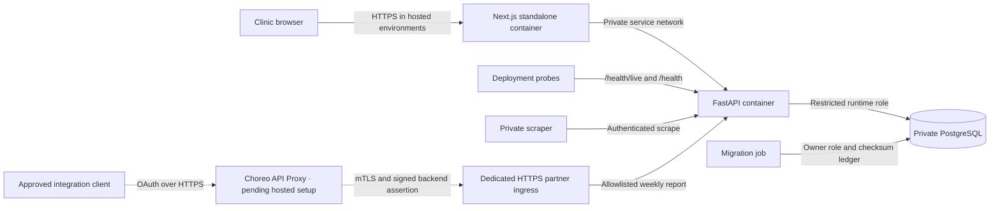
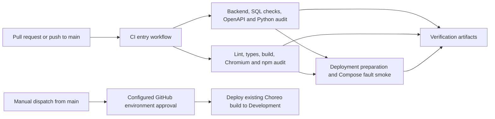

# QueueSense deployment guide

Use the local synthetic demo to review the clinic product. Use Docker to verify the packaged stack. The production runbook covers the owner-approved staging and promotion sequence.

## Run the full synthetic demo

Use Python 3.12, Node.js 22 and PostgreSQL 17 on macOS or Linux. Run these commands from the application repository root, which contains `backend/`, `frontend/` and `docker-compose.yml`. If PostgreSQL binaries are outside the default Apple Silicon location, set `POSTGRES_BIN` to the directory containing `initdb` and `pg_ctl`.

```sh
python3.12 -m venv .venv
.venv/bin/pip install -r backend/requirements.lock
npm ci --prefix frontend
python3.12 data/generator/generate.py --preview /tmp/queuesense-demo-summary.json
.venv/bin/python -m backend.local_setup
.venv/bin/python -m backend.bootstrap_product
.venv/bin/python -m backend.verify_local
```

The verifier seeds the synthetic history when the local database has no departments and checks the migrations and runtime grants. The launcher reruns bootstrap after seeding so the demo doctor can be linked to a clinician. The trained model is included in this checkout.

```sh
export JWT_SIGNING_SECRET="$(.venv/bin/python -c 'import secrets; print(secrets.token_urlsafe(32))')"
export APP_ENV=development
export ENABLE_DEMO_LOGIN=true
export ENABLE_AUTOMATION=false
export DB_POOL_MAX_SIZE=8
.venv/bin/python scripts/start_local.py
```

Open `http://127.0.0.1:3001` and select a role under **Explore the demo**. The local launcher supports same-network device testing and binds the API and database to loopback. Use a trusted network and synthetic data. If you already have a local API process, restart that dedicated process to pick up new environment settings. The launcher leaves an already responding process in place. [Backend configuration](../backend/README.md) · [Synthetic data](../data/data_dictionary.md)

## Verify the container release

```sh
python3 scripts/smoke_compose.py --faults
```

The smoke uses its own containers, volume, port assignments and runtime secrets. It verifies frontend rendering, API and database readiness, login, queue persistence, 429 and outage recovery. To keep a working local stack, follow [Docker setup](DOCKER_SETUP.md) and configure the two distinct database passwords in an ignored `.env` file.

## Deployment architecture



Compose uses a named database volume and waits for migrations and readiness. The app containers run as non-root users. For hosted staging, use private database connectivity, deploy the approved images, provision TLS and secrets, and configure the Choreo proxy using synthetic records. [Production runbook](PRODUCTION_DEPLOYMENT.md) · [Deployment checklist](DEPLOYMENT_CHECKLIST.md)

## CI/CD architecture



The optional Choreo workflow uses a checksum-verified WSO2 CLI and a configured environment secret. It targets Development. Hosted execution requires appropriate organization access and setup. [Workflow details and artifacts](CICD_PIPELINE.md) · [Developer Portal steps](DEVELOPER_PORTAL_GUIDE.md)
