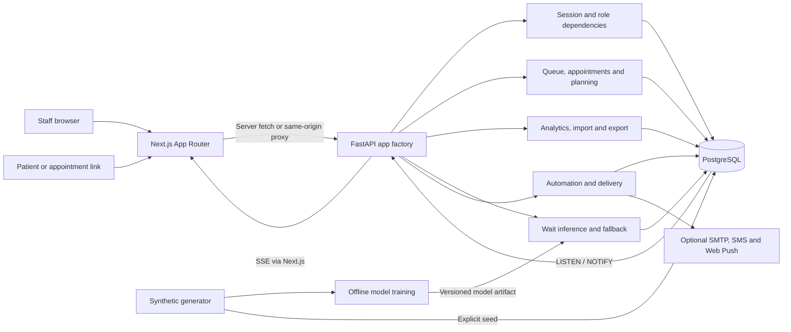

# Existing QueueSense architecture

This is the as-built baseline from commit `3dec54c`. The [project audit](PROJECT_AUDIT.md) records fresh verification and the [technical debt register](TECHNICAL_DEBT.md) records gaps.

## Frontend and request flow

| Boundary | Current design | Source |
| --- | --- | --- |
| Entry and rendering | App Router pages serve the landing/role chooser, protected role workspace, recovery, patient status, self-check-in and demo data preview. The workspace server verifies the cookie and fetches the role workspace contract before rendering client controls. The demo preview uses a bundled summary. | [App routes](../frontend/app), [workspace page](../frontend/app/workspace/%5Brole%5D/page.tsx), [server auth](../frontend/services/auth.ts), [demo page](../frontend/app/demo-data/page.tsx) |
| Client UI | The client portal coordinates navigation, data fetching and mutations. Feature components handle appointments, the reception desk, accounts, planning, reports, feedback, delivery and charting. UI role checks control navigation and affordances. FastAPI owns enforcement. | [Portal](../frontend/components/portal.tsx), [components](../frontend/components) |
| Browser API | Next.js allows only listed backend paths. Both proxies forward the opaque session cookie and check exact configured origins on writes. Auth limits payloads to 4 KiB and forwards cookies and retry hints. Services accept up to 2,100,000 bytes, buffer regular responses, and stream SSE. Direct server page fetches use the configured API address. | [Auth proxy](../frontend/app/api/auth/%5B...path%5D/route.ts), [service proxy](../frontend/app/api/service/%5B...path%5D/route.ts), [server auth](../frontend/services/auth.ts) |
| Updates and cache | Browser EventSource reconnects and polls every 15 seconds while unavailable. PostgreSQL sends change signals after commit. The service worker stores a generic offline page and fetches navigation from the network. Private pages use no-store, noindex and referrer suppression. | [Live hook](../frontend/components/live-updates.ts), [SSE routes](../backend/arrivals.py#L183), [service worker](../frontend/public/sw.js), [headers](../frontend/next.config.ts) |

## Backend and trust boundaries

[The app factory](../backend/app.py) owns configuration, psycopg connection creation, origin and response headers, error handling, login, the staff dependency and health. Feature modules attach handlers to that app. Most use synchronous psycopg and execute SQL in a transaction context. SQL is embedded in handlers and helper functions, while [backend services](../backend/services) provide reusable analytics, reports, import, prediction, monitoring and insights. There is no ORM. Pydantic input types live mainly with their routes. Many responses are assembled from dictionaries and SQL rows.

- **Staff authentication.** Passwords use Argon2id. The browser receives a random HttpOnly, SameSite=Lax session cookie with an eight-hour default lifetime and Secure in production. PostgreSQL stores its hash. Each protected request fetches the current active user and persisted role. Logout, password reset, and changes to access revoke sessions. Administrator TOTP and recovery use the [account module](../backend/accounts.py) and [security helpers](../backend/security.py).
- **Staff authorization.** Admins configure the clinic, manage users and read audits. Reception handles arrivals, bookings and queue operations. Doctors operate only their linked clinician for protected mutations. Managers access planning, analytics and reports. Several shared operational reads accept all authenticated staff. The exact read policy needs to be recorded before defining client scopes.
- **Patient/appointment authorization.** A private link is a bearer capability scoped by database lookup. It can grant status, QR, private notifications, feedback or delivery preferences depending on its type. A walk-in kiosk code has a separate daily use policy. These credentials have a different purpose from staff login or future API access tokens.
- **Execution and transactions.** Check-in locks the department/day session to assign a token number, writes events and audit rows together, and records an initial estimate when available. Queue state changes lock the affected token, enforce state/clinician rules, and update events/availability before commit. Constraints backstop cross-department assignment and active clinician occupancy.
- **Background work.** The API lifespan starts automation unless disabled. It runs queue and appointment checks, then processes the notification outbox. PostgreSQL advisory locks and unique event keys coordinate workers. Provider delivery has at-least-once semantics.

## FastAPI operation inventory

Generated OpenAPI reports **87 distinct paths and 98 operations** (44 GET, 49 POST, 5 PATCH). Each entry below describes a route path or explicitly identifies a common prefix. FastAPI's generated documentation routes are outside the operation count. Paths are unversioned even though the schema's metadata says `1.0.0`. The default API exposes documentation internally on `/docs`, `/redoc` and `/openapi.json`. No OpenAPI security scheme is declared.

| Domain and source | Path and method |
| --- | --- |
| Health and identity — [app](../backend/app.py), [services health](../backend/experience.py) | GET `/health`, `/health/services`, `/auth/me`, `/auth/workspace/{role}`; GET/POST `/auth/demo`; POST `/auth/login`, `/auth/logout` |
| Accounts — [accounts](../backend/accounts.py) | GET/POST `/auth/profile`; GET `/auth/sessions`; POST `/auth/sessions/{session_id}/revoke`, `/auth/password`, `/auth/mfa/setup`, `/auth/mfa/confirm`, `/auth/mfa/disable`, `/auth/recovery/request`, `/auth/recovery/reset`, `/auth/recovery/admin/{user_id}` |
| Queue and clinician operations — [product](../backend/product.py), [paging](../backend/table_pages.py), [events](../backend/arrivals.py) | GET `/departments`, `/staff`, `/schedules`, `/queue/live`, `/queue/page`, `/queue/events`, `/queue/{token_id}/private-link`; POST `/queue/check-in`, `/staff/{staff_id}/call-next`, `/queue/{department_id}/close`; PATCH `/queue/{token_id}/status`, `/staff/{staff_id}/availability` |
| Appointments and kiosks — [arrivals](../backend/arrivals.py), [automation](../backend/automation.py) | GET/POST `/appointments/slots`, `/appointments`, `/checkin/kiosks`, `/self-checkin/{key}`; GET `/appointments/risks`, `/self-checkin/{key}/qr`; POST `/appointments/{appointment_id}/cancel`, `/checkin/kiosks/{kiosk_id}/revoke`, `/self-checkin/{key}/confirm` |
| Patient status — [product](../backend/product.py), [events](../backend/arrivals.py), [feedback](../backend/experience.py), [planning](../backend/planning.py) | GET `/patient/{key}`, `/patient/{key}/qr`, `/patient/{key}/events`, `/patient/{key}/doctors`; GET/POST `/patient/{key}/feedback`; GET `/feedback/summary` |
| Inboxes — [automation](../backend/automation.py) | GET `/notifications`, `/patient/{key}/notifications`, `/self-checkin/{key}/notifications`; POST the `/{notification_id}/read` suffix on each of those three |
| External delivery preferences — [delivery](../backend/delivery.py) | On each of `/delivery/targets`, `/patient/{key}/delivery`, and `/self-checkin/{key}/delivery`: GET/POST the base path and POST the `/push`, `/{channel}/disable`, `/{channel}/verify` suffixes |
| Analytics, planning, alerts and reports — [product](../backend/product.py), [planning](../backend/planning.py), [automation](../backend/automation.py) | GET `/analytics/summary`, `/models/performance`, `/alerts`, `/planning/balance`, `/planning/forecast`, `/planning/congestion`, `/reports/export`; POST `/simulation/staffing`, `/predict/wait-time`, `/alerts/refresh`, `/alerts/{alert_id}/resolve`, `/planning/doctors`, `/planning/simulate`, `/data/import` |
| Admin and audit — [product](../backend/product.py), [paging](../backend/table_pages.py), [profiles](../backend/planning.py) | GET/POST `/admin/users`; GET `/admin/users/page`, `/admin/doctor-options`, `/audit`, `/audit/page`; POST `/admin/departments`, `/admin/staff`, `/admin/staff/{staff_id}/schedule`; PATCH `/admin/users/{user_id}`, `/admin/departments/{department_id}`, `/admin/staff/{staff_id}/profile` |

## Data and prediction

| Migrations | Responsibility |
| --- | --- |
| [001–003](../database/migrations) | Users, departments, staff, shifts, queue sessions/tokens, service events, availability, models, predictions, alerts, audits, reporting views and event integrity triggers. |
| [004–006](../database/migrations) | Session and attempt records, patient capabilities, import keys, partial unique indexes, appointment capacity and bookings, kiosks, retry records and notifications from SQL changes. |
| [007–009](../database/migrations) | Visit feedback, structured audit context, clinician service/language capabilities and visit requirements. |
| [010–012](../database/migrations) | Reminder and inbox state, initial prediction snapshot and priority reference, profiles and MFA/recovery, external destinations and delivery outbox, paging indexes. |

The [migration runner](../database/scripts/manage.py) applies ordered, checksummed SQL under a transaction advisory lock. Demo seed is explicit and requires an empty department table. The API connects with a restricted role. [Runtime grants](../database/sql/product_runtime_grants.sql) are applied separately. Department/day, staff assignment and queue history are modeled directly in PostgreSQL, with department-local analytics dates alongside application paths that assume Asia/Colombo.

The [data generator](../data/generator/generate.py) creates fictional operational records. The [training script](../ml/src/train.py) replays historical features, uses date-ordered train/validation/test splits, and writes versioned evaluation results and a bundled model. [Inference](../backend/services/prediction.py) calculates live position and estimates per department working set. [Monitoring](../backend/services/monitoring.py) measures errors using the latest eligible pre-service estimate. [Metrics and reports](../backend/services) share filter and wait calculations. Clinic use requires an independent privacy and model validation decision.

## Deployment and configuration

| Scope | Settings and behavior |
| --- | --- |
| Local native | [Launcher](../scripts/start_local.py), [local setup](../backend/local_setup.py) and [bootstrap](../backend/bootstrap_product.py) run a private local database and API and start the Next.js process. `POSTGRES_BIN`, `APP_HOST`, `APP_PORT`, and ignored private files under `.local/` support native operation. The launcher publishes the frontend for LAN use. |
| Containers | [Compose](../docker-compose.yml) runs the database, one-shot migrate and optional seed, API and frontend. `POSTGRES_PASSWORD` supports provisioning. Compose maps `AUTH_DATABASE_URL` into API `DATABASE_URL`, and configures server-only frontend `AUTH_API_URL`. `HOST_BIND_ADDRESS`, `FRONTEND_PORT`, `LOCAL_BIND_ADDRESS`, `POSTGRES_PORT` and `API_PORT` control host exposure. [Dockerfiles](../docker-compose.yml) reference build stages in each application directory. |
| API and browser | `APP_ENV`, `FRONTEND_ORIGINS`, `ENABLE_DEMO_LOGIN` and `ENABLE_AUTOMATION` control production checks and app behavior. `ACCOUNT_ENCRYPTION_KEY` is used by encryption and code hashing. `SMTP_*`, `TWILIO_*`, `VAPID_*` and `PUSH_ALLOWED_HOSTS` configure optional providers. [Environment template](../.env.example) |
| Verification | `TEST_DATABASE_URL` points the backend suite at a test DB. Browser scripts accept `BASE_URL`. Locust reads `QUEUESENSE_PATIENT_KEY` from the runtime environment. CI runs backend suites, generator, database verification, type check, build and one browser script. [CI](../.github/workflows/ci.yml), [test suites](../frontend/tests), [load test](../loadtests/locustfile.py) |

No external gateway, JWT issuer or Developer Portal configuration appears in the tracked repository.
