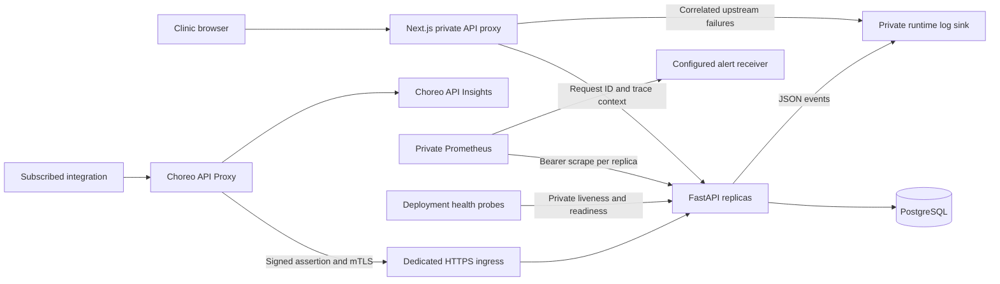

# QueueSense observability architecture

Next.js issues a fresh request ID at its proxy boundary and forwards it to FastAPI. It uses that ID to initialize W3C trace context on the upstream request. FastAPI validates incoming context and records a bounded trace ID in application logs. Given a request ID, operators can find the proxy failure and related backend events. Trace context is available for a compatible collector or ingress that forwards it. A configured collector and span instrumentation would be needed for distributed span export. Confirm context forwarding in the selected hosted gateway before promising cross-gateway trace continuity. [W3C Trace Context](https://www.w3.org/TR/trace-context/)

FastAPI records only route templates, standard methods, status, time and correlation fields. Unknown paths share the `<unmatched>` label. The telemetry excludes request bodies, credentials, token keys, query strings, user identifiers, patient details and SQL. Keep Uvicorn access logs disabled and configure ingress log policies so URL capabilities and authentication headers stay private. Give log and metrics access to operational roles. Set retention and export controls for the intended environment.

The scrape route is registered only with an explicit token and is excluded from OpenAPI and application traffic counts. Browser and partner ingress allowlists keep it private. Readiness depends on a simple query using the PostgreSQL application role. Liveness checks the process independently, allowing a deployment to stop routing to an unready application while keeping it available for recovery.

The private application counters describe requests FastAPI handled. Choreo API Insights covers the published partner API, including requests the gateway rejects. Compare the two over the same environment and time range. [Monitoring setup](MONITORING.md)
