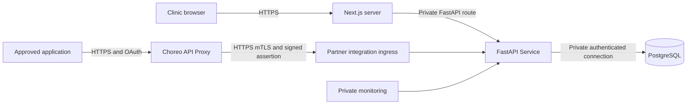

# QueueSense production deployment

The release candidate is verified first in an isolated synthetic environment. Production requires approved infrastructure, a private database, a documented rollback owner, and acceptance of the staging evidence. Record the actual image digests and endpoint addresses from the approved environment.

## Runtime and trust boundaries

The clinic browser uses Next.js for patient and staff flows. The managed Choreo API Proxy exposes the read-only weekly waiting-time aggregate for subscribed integrations. This keeps the patient registration, queue mutations, staff credentials and private tracking links within the clinic application boundary. A clinic frontend route through Choreo would require a separate approved private gateway design, contract and staging verification. [Gateway boundary and trust model](../api-management/gateway-design.md)

## Deployment sequence

1. Run repository CI and security checks for the release commit. Build both container images from the application repository root. Use the recorded digests for staging and promotion. Confirm the target registry and deployment account are approved. [CI/CD pipeline](CICD_PIPELINE.md)
2. Provision private PostgreSQL. Take a backup, verify restoration in a disposable database, and apply all numbered migrations with the database owner connection. Verify both runtime grant scripts for `queuesense_auth`. Give FastAPI the runtime credential and TLS trust of the database service. Register the model release from the matching evaluation metadata. [Database design](DATABASE_DESIGN.md) · [Deployment and model registry](DEPLOYMENT.md)
3. Deploy the private FastAPI container. On Choreo, use the verified Docker Service workflow for port 8001 with project network visibility. Set HTTP liveness to `/health/live` and HTTP readiness to `/health`. Check the runtime account's readiness query and confirm production mode hides the live OpenAPI schema. [Service setup](../api-management/choreo-integration-plan.md#owner-console-steps-for-the-private-service) · [Official health checks](https://wso2.com/engineering-platform/developer-platform/docs/devops-and-ci-cd/set-up-health-checks/)
4. Deploy the Next.js standalone container on a runtime that supports server-side Next.js with private connectivity to FastAPI. Set the exact HTTPS clinic origin in both services. Terminate HTTPS at the clinic ingress, preserve the browser Host and Origin, and verify that the frontend can reach the private API to handle sign-in, streaming queue status and authorization. [Docker runtime setup](DOCKER_SETUP.md)
5. Configure the dedicated HTTPS partner ingress and import the partner contract into the Choreo API Proxy. Verify the final Target path, mutual TLS, OAuth requirements, signed assertion audience and context, department grant, cache controls and API rate limits in Development. Test with an approved subscriber and synthetic records. [Proxy configuration](../api-management/proxy-configuration.md) · [Gateway test matrix](../api-management/gateway-testing.md)
6. Enable approved monitoring and verify both health probes, runtime logs, alert notifications and Choreo API Insights. Keep the metrics route and the scraper private. [Monitoring runbook](MONITORING.md)
7. Review the deployment checklist. Promote only with owner approval and after both staging routes pass. Verify the real production endpoint, release revision, gateway policies and subscriber visibility before any production publication. [Release checklist](DEPLOYMENT_CHECKLIST.md) · [Developer Portal guide](DEVELOPER_PORTAL_GUIDE.md)

## Environment configuration

| Runtime | Value |
| --- | --- |
| FastAPI | `APP_ENV=production`, `ENABLE_DEMO_LOGIN=false`, exact `FRONTEND_ORIGINS`, private `DATABASE_URL` for the restricted role, and the environment's `JWT_SIGNING_SECRET` from the secret manager. |
| FastAPI | Unique environment issuer and audience, appropriate access and refresh lifetimes, and measured statement and lock timeouts. Use `DB_POOL_MAX_SIZE=8` as the tested starting point for one worker per replica. Budget all workers’ pool sizes, SSE listeners, jobs and administrative connections below the PostgreSQL connection limit. |
| FastAPI | Start staging with `ENABLE_AUTOMATION=false`. Configure automation and external notification credentials separately after approval. Enable JSON request logs. Provide `METRICS_BEARER_TOKEN` only if a private scraper is configured. |
| FastAPI partner origin | Set all five `CHOREO_…` variables from verified Development or Production trust values. Keep the integration route disabled until the corresponding ingress and trust configuration are in place. |
| Next.js | Point `AUTH_API_URL` at the privately reachable FastAPI address. Set exact `FRONTEND_ORIGINS`. Serve the standalone process on its configured port. |
| Gateway and ingress | Use approved certificate trust, TLS keys, subscription plans, an OAuth client and verified endpoint DNS. Keep each environment separate. |

Store JWT keys, database credentials, scraper tokens and external provider credentials in the platform secret store. Keep URLs, diagnostic traces and raw logs that contain private patient links or credentials out of release records.

## Rollback

Keep the previous application image digests and the gateway deployment and configuration revision. On verification failure, pause promotion and restore the previous compatible images or gateway deployment. Confirm database schema compatibility before rolling back the application. Data/schema restoration requires an approved recovery plan and a verified backup. Confirm readiness and rerun the clinic and partner smoke checks after restoration.
