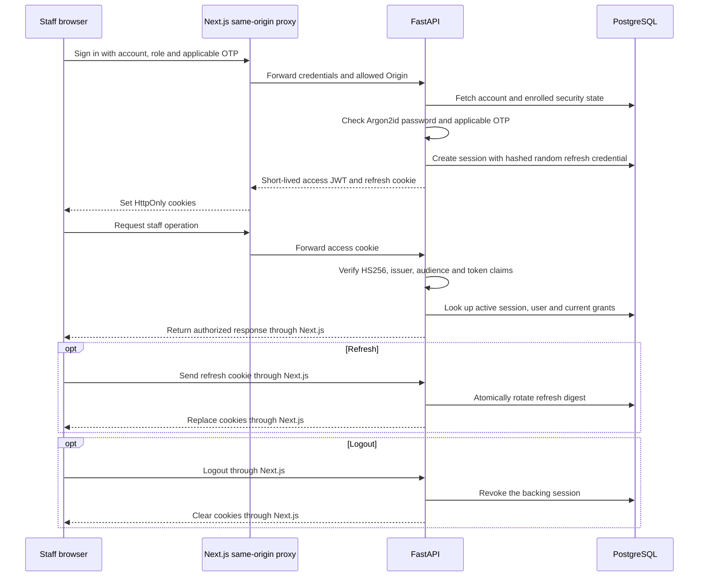

# QueueSense Enterprise security architecture

QueueSense separates staff sessions, patient capabilities and partner integration credentials. FastAPI enforces route permissions, resource ownership and database-backed session revocation. The hosted Choreo design adds OAuth, subscriptions and an independent traffic policy for the partner API. [Gateway request flow](SYSTEM_ARCHITECTURE.md#partner-gateway-request-flow)

## Staff JWT flow

Production requires a signing secret, HTTPS origins and disabled demo sign-in. The access token defaults to 10 minutes. The refresh session defaults to an absolute eight hours, with rotation of its random credential. HttpOnly cookies restrict JavaScript access and production cookies are Secure. Private v1 clients can use bearer access JWTs. Route permissions and current grants are checked at the backend. [JWT policy and key rotation](JWT_AUTHENTICATION.md) · [Permissions](ROLE_PERMISSION_MATRIX.md)

## Other trust boundaries

| Principal | Credential and scope |
| --- | --- |
| Patient | High-entropy capability URL scoped to a visit, booking or kiosk workflow. Its possession permits only the actions applicable to that resource. Keep links private and out of request/edge logs. |
| Approved partner client | Presents an OAuth 2.0 bearer token to the planned Choreo API Proxy. Gateway subscription and authentication are verified during hosted rollout. |
| Partner origin request | The HTTPS ingress requires a client certificate. FastAPI verifies one RS256 backend assertion against trusted JWKS, checks issuer, audience, validity, signed proxy context and the configured department, and enforces the origin quota. |
| API runtime | Limited PostgreSQL grants separate the service from the schema owner. Secrets are supplied via environment-specific secret management. |
| Scraper | Dedicated bearer secret and private network reachability for metrics. Sensitive identifiers and capability URLs are excluded from metric labels. |

The partner pilot binds one configured department to one exact signed Choreo API context. Per-application grants within a shared proxy would require a separately verified identity claim and grant model. The documented client-credentials claim shape informed this choice. [Gateway trust model](../api-management/gateway-design.md) · [Official backend assertion profile](https://wso2.com/engineering-platform/developer-platform/docs/developer/authentication-and-authorization/pass-end-user-attributes-to-upstream-services/)

Application controls include exact Origin checks on mutations, typed inputs, restricted response projections, no-store on private responses, and correlation IDs on sanitized errors. Before a real-clinic rollout, confirm log redaction at every hop, rotate secrets and trust per environment, approve patient-link retention rules, and review aggregate privacy. [Security audit](SECURITY_AUDIT.md) · [Traffic management](TRAFFIC_MANAGEMENT.md) · [Production checklist](DEPLOYMENT_CHECKLIST.md)
