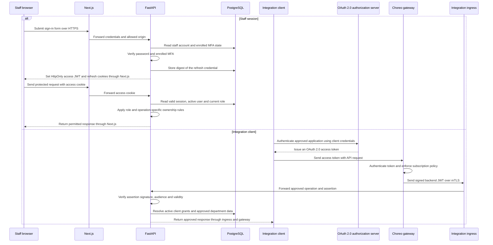

# QueueSense Enterprise security architecture

**Target design · Stage 2 · 25 November 2026**

Authenticate staff browser sessions, patient links and integration clients with distinct credentials and authorization rules. Maintain FastAPI as the authority for role, ownership and field-level access. The gateway manages external consumer authentication, subscriptions and traffic policies. PostgreSQL retains the clinic's staff roles and session state. [Stage 1 findings](TECHNICAL_DEBT.md#security-privacy-and-correctness) · [API architecture](API_ARCHITECTURE.md)

## Authentication flow

### Staff and patient access

- Preserve Argon2id, server-side session hashing, logout and revocation, Secure/HttpOnly/SameSite cookie settings in production, and exact browser Origin validation on mutations. Resolve current role and active status on each protected request. Keep enrolled administrator TOTP and audited recovery. [Existing auth](../backend/app.py) · [Account controls](../backend/accounts.py)
- Keep the patient-token, appointment and walk-in kiosk capabilities scoped to their existing objects. Preserve their distinct expiry and retry behaviors during the architecture transition. Design explicit retention, expiry and revocation requirements with the clinic before accepting real patient data. Apply no-store, no-referrer and noindex protections to private link views. [Arrivals](../backend/arrivals.py) · [Web headers](../frontend/next.config.ts)
- QueueSense issues short-lived staff JWTs and validates the backing session on each request. The Choreo integration described below uses separate credentials and trust. [Implemented staff JWT policy](JWT_AUTHENTICATION.md)

### Integration JWT trust

Use the documented **signed backend JWT** as FastAPI's integration credential. The consumer presents its OAuth 2.0 access token to Choreo. Choreo can send a distinct signed assertion in `X-JWT-Assertion` upstream and can be configured with an audience for that assertion. Require an audience dedicated to this QueueSense integration environment. Confirm the exact issuer, signing algorithm, regional JWKS, claim names and stable application identity in staging. Application grants must come from an active local registration linked to the verified client identity. Client-credentials assertions can have a different claim set from user assertions. [Official upstream JWT and JWKS guidance](https://wso2.com/engineering-platform/developer-platform/docs/developer/authentication-and-authorization/pass-end-user-attributes-to-upstream-services/)

FastAPI should enforce signature verification with an allowlisted algorithm and configured JWKS, exact issuer and audience, unexpired `exp`, any present `nbf` and a bounded clock tolerance. Use a cached key set with controlled refresh for an unknown key ID, and fail closed if validation cannot complete. Keep keys and audiences separate by environment. Select and verify the supported OAuth client-credentials issuer in that organization. Treat verified backend JWT identity and successful authenticated ingress as joint requirements. Reject direct requests to the integration router from unauthenticated paths and reject missing, invalid or ambiguous assertions. Exercise gateway header replacement and reject duplicate assertion headers at the origin ingress. [Official gateway-to-origin mTLS guidance](https://wso2.com/engineering-platform/developer-platform/docs/authentication-and-authorization/secure-communication-between-the-choreo-gateway-and-your-backend-with-mutual-tls/)

## Authorization

| Principal | Allowed by default in the target design | Restriction |
| --- | --- | --- |
| Patient capability | Linked visit status and eligible feedback or arrival actions. | Capability scope, current status and expiry policy. |
| Receptionist | Patient check-in, queue coordination, private receipt reissue and appointment management. | Staff session, permitted procedures and audit records. |
| Doctor | Availability and service actions for the linked clinician. | Ownership, eligibility, location in the queue and state transitions. Review shared operational reads by field. |
| Administrator | Staff access, clinic configuration, audits and authorized support operations. | Active administrator role. Audit sensitive changes and enforce MFA policies at deployment. |
| Manager | Operational analytics, planning, model/feedback monitoring and authorized report or historical import workflows. | Report and retention policy. No direct control over queue mutations in this role. |
| Integration application | Approved aggregate summary for allowlisted departments. | Active application registration and analytics grant. No staff role inheritance or access to individual visits. |

For sensitive reads and writes use explicit response schemas and fail-closed checks at the use-case boundary. Confirm the actual staff read matrix before hardening field visibility. The clinic can then approve access to free-text priority references, feedback comments and any other sensitive fields without relying on role names alone.

## Threats and controls

| Risk | Design control and release evidence |
| --- | --- |
| Credential leakage in logs | Emit templated route names and correlation IDs. Strip sensitive headers, request bodies, capability URLs, cookies, contact details and identifiers from logs and traces. Verify application, proxy, gateway and monitoring records using synthetic credentials. |
| Gateway bypass or assertion spoofing | Limit the ingress to approved integration paths. Require the gateway's TLS client identity at ingress and validate the assertion in FastAPI. Test direct-origin access, forged or duplicated assertion headers, and environment mismatch. |
| Recovery abuse and service overload | Keep generic responses, move eligible email work off the request path, retain per-account and per-client abuse controls, and measure shared rate-limit behavior. |
| Secret loss or rotation failure | Store database, vendor, encryption and TLS credentials in a secret manager. Validate production settings at startup. Back up and rotate encryption keys with compatibility for existing records, and rehearse issuer and certificate rotation in staging. |
| Excessive data or inferred individual visits | Publish aggregate fields only and approve small-cohort suppression, time range and filter policies. Review abuse across overlapping queries before allowing flexible cohort filters. Govern real data retention and audit access before launch. |
| Excessive database privilege | Keep separate migration and runtime credentials. Limit runtime privileges to needed schema actions, protect audit records from runtime edits, and use encrypted connections and backups. |

This layered design reduces credential exposure and preserves instant staff session revocation. It introduces multiple credential lifecycles and requires integration tests for mTLS, assertion verification and client grant revocation. The enterprise release depends on verified claims, reduced data exposure and documented owners for those controls.
