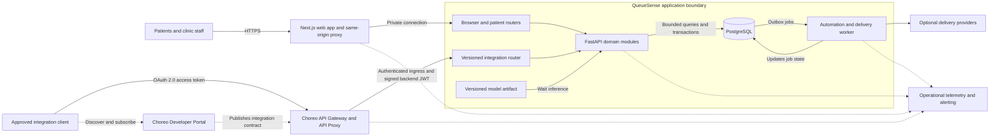
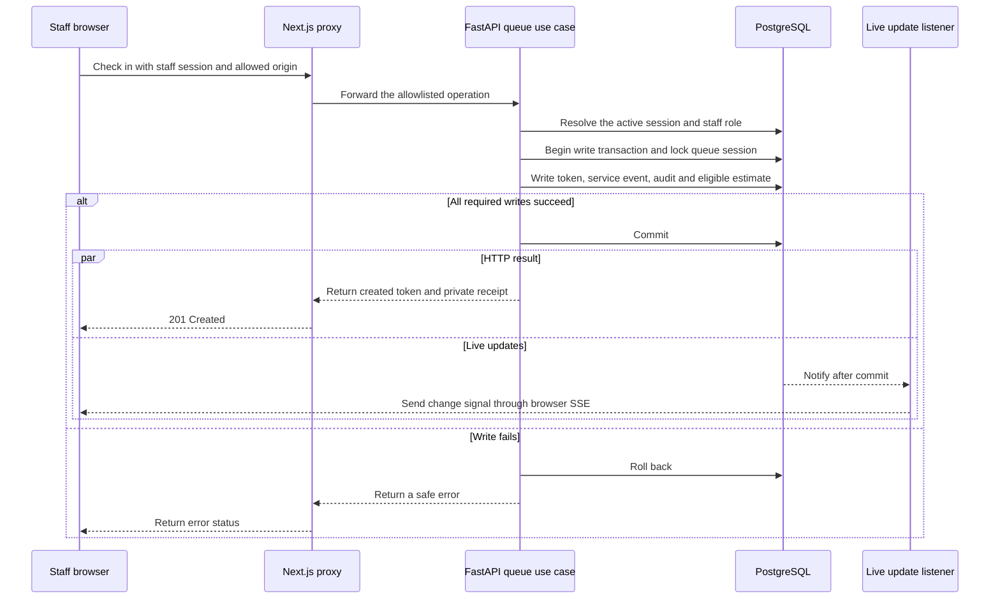

# QueueSense Enterprise system architecture

**Target design · Stage 2 · 25 November 2026**

QueueSense Enterprise should use a **modular FastAPI monolith**, a Next.js web application, and PostgreSQL as the operational source of truth. Choreo API Management provides the gateway and Developer Portal for approved integrations. The clinic browser continues to use Next.js and private FastAPI routes. This design assumes one clinic installation with multiple departments and preserves the existing synthetic-data workflows. The as-built system is documented separately. [Stage 1 audit](PROJECT_AUDIT.md) · [Existing architecture](EXISTING_ARCHITECTURE.md)

## High-level architecture

The integration router calls the same use cases and read logic as the browser routes. It has its own request types, authorization dependencies, and deliberately small response models. Jump to the [API architecture](API_ARCHITECTURE.md), [security architecture](SECURITY_ARCHITECTURE.md), or [deployment architecture](DEPLOYMENT_ARCHITECTURE.md).

## Users and primary workflows

| User | Main workflows |
| --- | --- |
| Patient | Confirm an eligible arrival, track the linked visit, receive status updates, and submit eligible visit feedback. |
| Receptionist | Check in patients, issue a private token link, manage appointments and coordinate queues. |
| Doctor | Manage the linked clinician's availability and service progression. Consult the queue information allowed by staff policy. |
| Administrator | Manage accounts, role assignments, departments, clinician records and audit access. Handle authorized support and queue tasks. |
| Manager | Review waiting times and capacity, use staffing simulations, and export authorized reports. |

## Module ownership

These are code boundaries inside one backend. HTTP adapters depend on application use cases. Use cases own policy, transaction scope and the invocation of SQL or provider adapters. Modules exchange explicit commands and results with typed schemas. Database constraints remain the last line of protection for shared invariants.

| Module | Owns | Starting point |
| --- | --- | --- |
| Identity and access | Staff authentication, sessions, role checks, account settings and audit of access changes. Integration identities resolve to separate client grants. | [App factory](../backend/app.py), [accounts](../backend/accounts.py), [security](../backend/security.py) |
| Queue operations | Check-in, numbering, priority and eligibility, lifecycle transitions, events, private status and visit feedback. | [Product routes](../backend/product.py), [feedback](../backend/experience.py), [integrity migrations](../database/migrations) |
| Clinician and arrivals | Department and clinician configuration, schedules, availability inputs, booking capacity, kiosk links and idempotent arrival. Queue operations and arrivals can share one transaction where issuing a token requires both modules. | [Product routes](../backend/product.py), [planning](../backend/planning.py), [arrivals](../backend/arrivals.py) |
| Analytics and prediction | Wait inference, capacity fallback, operational and model metrics, demand planning, imports and reports. | [Services](../backend/services), [model training](../ml/src/train.py) |
| Automation and delivery | Reminders, inboxes, consented destinations and delivery retries. Keep the PostgreSQL outbox and a separately runnable worker from the same backend image when deployment work reaches that step. | [Automation](../backend/automation.py), [delivery](../backend/delivery.py) |
| Infrastructure | Typed config, database connections, HTTP policies, observability, health probes and application startup. | [App factory](../backend/app.py), [health probes](../backend/experience.py) |

## Database interaction

PostgreSQL continues to enforce department ownership, valid transitions and one active token per clinician. The existing queue ordering and appointment retry behavior stay regression invariants. Keep live events as change signals, and reload authoritative state after reconnect. Measure whether a listener per API process and a bounded request pool improve connection usage under load. Always bound report queries and their concurrency so staff mutations retain capacity. [Database schema](../database/migrations) · [Live updates](../backend/arrivals.py#L183) · [Technical debt](TECHNICAL_DEBT.md)

## Waiting-time analytics

Keep training offline and promote a versioned model artifact together with its metadata. Runtime reuse of the same prediction logic keeps clinic displays consistent, preserves the initial estimate versus actual wait, and allows a capacity fallback when the model is unavailable or the visit has constraints outside its features. Track prediction availability, observed MAE, sample size and model version. Treat the existing synthetic evaluation as baseline evidence and validate against appropriately governed clinic data before setting accuracy targets. [Model design](../ml/README.md) · [Inference](../backend/services/prediction.py) · [Observed monitoring](../backend/services/monitoring.py)

## Architecture trade-offs

| Choice | Advantage | Cost or limit |
| --- | --- | --- |
| Modular monolith | One transaction can cover check-in, visit state, service events and auditing. Existing deployment and PostgreSQL remain useful. Modules can be tested and changed incrementally. | Release and failure boundaries are shared. Slow reporting, CPU-heavy inference and provider backlogs need measurable resource limits. |
| Microservices | Independent scaling, ownership and isolation can benefit separately operated workloads. | Distributed transactions, event delivery, reconciliation, service identity and deployment overhead would complicate tightly coupled queue operations at the current scale. |
| Next.js, FastAPI and PostgreSQL | Reuses current UI, authentication behavior, Python model stack, SQL migrations and transactional constraints. | Next.js and FastAPI need synchronized route contracts. PostgreSQL connections, queries and locks need explicit operational budgets. |
| Choreo managed gateway | Gives approved integrations a managed API entry point and a portal lifecycle. | Adds a network hop and an external dependency. Environment parity, certificates and proxy behavior require staging evidence. [Official API Proxy workflow](https://wso2.com/engineering-platform/developer-platform/docs/develop-components/develop-proxy/develop-an-api-proxy-from-an-open-api-specification/) |

Start with the worker as a separate process of the same backend if provider work affects API latency or deployment cadence. Consider an analytics read replica or precomputed aggregates only after queries measurably compete with queue writes and freshness requirements are agreed. Consider a distinct inference service only if profiling demonstrates a materially different scaling need. Keep queue, booking and audit writes together while they share an atomic consistency requirement.
