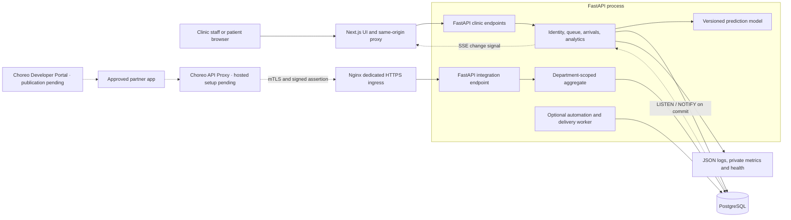
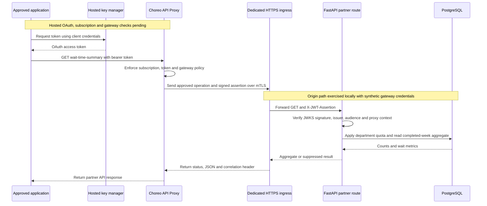
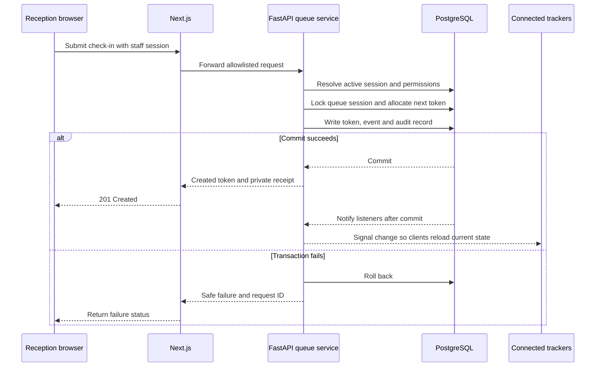

# QueueSense Enterprise system architecture

QueueSense runs a Next.js web server, a modular FastAPI monolith and PostgreSQL. The clinic path and the partner integration have separate entry points. The clinic stack and the dedicated HTTPS partner ingress have been exercised locally. The Choreo-managed portion requires hosted configuration. [Staging evidence](END_TO_END_TEST_REPORT.md)

## System overview

| Boundary | Responsibility and source |
| --- | --- |
| Next.js | Role workspaces, private tracking and a same-origin allowlist that forwards clinic auth, JSON, reports, images and SSE. [Proxy source](../frontend/services/api-proxy.ts) |
| FastAPI adapters | Browser-compatible routes, versioned staff endpoints and the conditional partner operation. Schemas validate inputs and constrain outputs. [App factory](../backend/app.py) · [v1 routes](../backend/api/v1) |
| Application modules | Identity, clinic operations, scheduling and arrivals, reports, inference, and optional delivery. [Services](../backend/services) · [Arrivals](../backend/arrivals.py) · [Automation](../backend/automation.py) |
| Data access | Psycopg transactions and parameterized SQL. Optional request pool for short database work. SSE retains dedicated listener connections. [Database runtime](../backend/database.py) · [Repositories](../backend/repositories) |
| PostgreSQL | Staff sessions and grants, clinic records, events, audits, reporting history and shared request budgets. [ER diagram](DATABASE_DESIGN.md#entity-relationships) |
| Operations | Health checks, per-worker metrics and scoped JSON logs. [Monitoring architecture](OBSERVABILITY_ARCHITECTURE.md) |

## Partner gateway request flow

The proxy exposes `GET /wait-time-summary`. The HTTPS Target supplies the base path `/api/integrations/v1`. The ingress forwards the allowed operation and drops consumer cookies and Authorization. FastAPI verifies the gateway assertion and enforces the configured department. The application enforces its own 30-read-per-minute quota and suppresses cohorts with fewer than ten measured waits. [Gateway and ingress configuration](../api-management/proxy-configuration.md) · [Partner contract](../api-management/openapi.yaml)

## Queue transaction and live updates

A modular monolith keeps transactions and deployment straightforward. Reporting, inference and notifications share runtime resources. Benchmark those workloads before introducing separate services. Read replicas, precomputed aggregates or a dedicated worker become useful when measured contention, independent scaling or separate ownership warrants them. [Decision records](TECHNICAL_DECISIONS.md) · [Deployment and CI diagrams](DEPLOYMENT_GUIDE.md)
